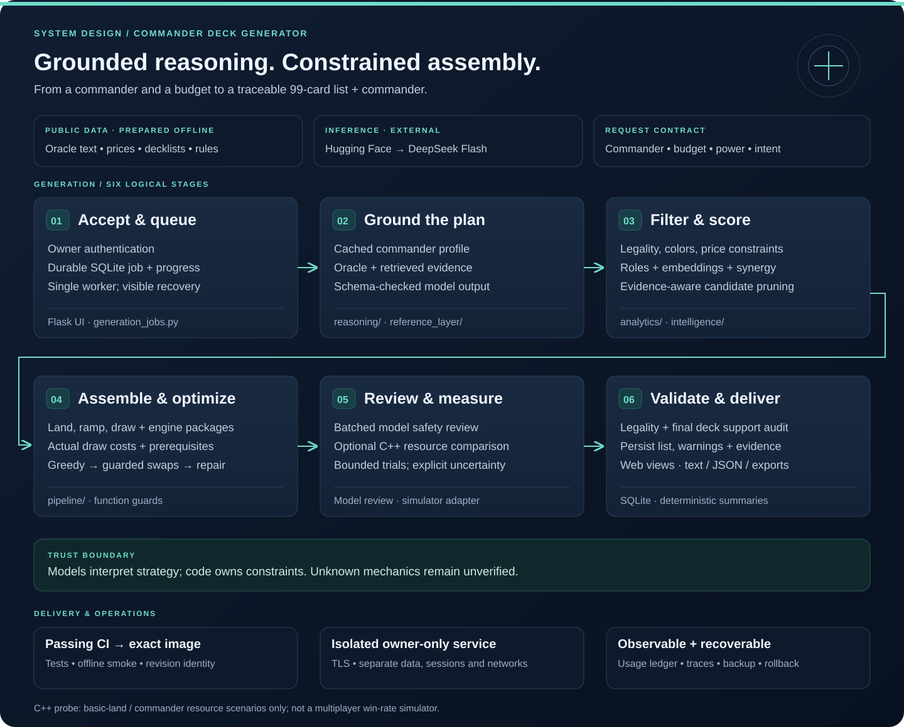

# Commander Deck Generator

**A constrained recommendation system for Magic: The Gathering, combining grounded AI reasoning with deterministic deck construction.**

[Case study](https://dylnmtthws.me/case-studies/deck-generator/) · [Recorded builds](https://dylnmtthws.me/deck-generator/) · [Run locally](docs/local-development.md) · [Hosted application](https://generate.decklab.studio)

Choose a commander, budget, power target, and strategy. The generator assembles a
99-card list plus its commander, with explanations, warnings, saved decks, and
text, JSON, Moxfield, or Archidekt exports. The hosted tool requires the owner's
admin login; the recorded builds are public.

The engineering challenge is turning an interpreted strategy into a list that
respects card rules, prices, and conditional abilities. The model interprets the
plan and reviews risky picks. Deterministic code owns selection and validation,
and records where evidence or supported mechanics fall short.

**Stack:** Python, Flask, SQLite, NumPy, CPU embeddings, and Hugging Face Inference Providers.

## How it works

1. **Ground the strategy.** Schema-validated commander profiles use card text and available reference evidence, with cached responses and provenance.
2. **Build within constraints.** Legal candidate filters, role scoring, protected infrastructure, greedy selection, swaps, and budget repair assemble the list.
3. **Review and explain.** A batched model review examines risky picks; final checks record unmet targets and uncertainty alongside exports and candidate traces.

Flask submits durable SQLite jobs to a single worker. Progress survives browser
reloads; abandoned jobs fail visibly after restart. Token usage and estimated
cost are recorded. [Operations and release process](docs/hosting.md).

## Engineering decisions

- **Separate interpretation from enforcement.** Typed model responses inform strategy; code enforces list constraints. Conditional draw parsing distinguishes printed mana value from activation costs and required support. [Route compiler](src/sabermetrics/intelligence/draw_routes.py).
- **Protect function during optimization.** Swaps and budget repair check supported card functions before accepting replacements. Conservative checks can also retain weak filler, which stays visible in diagnostics. [Function guard](src/sabermetrics/intelligence/function_guard.py).
- **Make improvements measurable.** Candidate traces explain exclusions, while paired evaluations hold data, profiles, and embeddings constant. A 220-card rule-matching study reproduced the reference matrix with 99.0% less matching time; this measures one scoring step. [Benchmark](docs/specs/informed-generation/validation.md).

## Evidence and limits

The [draw-route evaluation](docs/experiments/draw-routes/results.md) recorded
2,304 passing tests and 21 data-dependent skips. Eight paired offline builds
across four commanders passed mechanical validation. The new checks removed two
false draw-role assignments, but **final card membership did not change**. Traces
identified an unscored budget-completion fallback as the next selection problem.
These results establish a diagnostic correction, with deck quality still open.

The [public gallery](https://dylnmtthws.me/deck-generator/) preserves five historical
builds from October 2, 2026: all passed stored-catalog legality checks, and three
retained unresolved review flags. Those runs do not certify current hosted behavior.

Supported mechanics cover bounded text patterns. Power targets are heuristic,
prices depend on the data snapshot, and no win-rate improvement is established.
An optional C++ adapter probes narrow basic-land resource scenarios. Broader
competitive research and simulation live in [Deck Lab](https://github.com/DylnMtthws/deck-lab).

## Explore the code

Start with [deck assembly](src/sabermetrics/pipeline/),
[scoring](src/sabermetrics/analytics/), [model boundaries](src/sabermetrics/reasoning/),
and [tests](tests/). The [local development guide](docs/local-development.md)
contains setup and verification commands. Generation requires a Hugging Face credential.

Originally named Sabermetrics, this project retains its Git history from before
Deck Lab's extraction. Development is AI-assisted; bounded implementation and
review work is documented in the [validation record](docs/specs/informed-generation/validation.md)
and [draw-route study](docs/experiments/draw-routes/results.md).

[Contributing](CONTRIBUTING.md) · [Security](SECURITY.md) · [MIT license](LICENSE)

Unofficial fan project; not affiliated with Wizards of the Coast. Card data and artwork retain their original rights.
